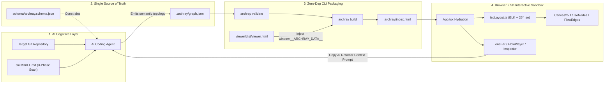

# ArchRay Product & Technical Architecture Specification

> **Document Purpose**: This document serves as the canonical product & architecture reference for **ArchRay**. It is structured so both human engineers and AI coding agents (Antigravity, Claude Code, Cursor, Gemini CLI) can rapidly understand the codebase, integrate ArchRay into other Git repositories, and extend or refactor ArchRay itself safely.

---

## 1. Product Definition & Design Philosophy

### 1.1 Problem Statement
Software architecture visualization typically breaks down in two ways:
1. **Static Diagram Rot (Mermaid / Draw.io / Excalidraw)**: Hand-drawn diagrams drift out of sync with actual source files within weeks and lack runtime interactivity, health diagnostics, or source-path traceability.
2. **LLM Visual Instability**: Asking an LLM to generate custom frontend visualization code (Canvas/SVG/HTML) from scratch for every project wastes tokens, produces overlapping node coordinates, and yields inconsistent aesthetics.

### 1.2 Core Separation-of-Concerns Paradigm
**ArchRay** solves both problems by strictly separating **AI Cognitive Decomposition** from **Deterministic 2.5D Rendering**:

| Layer | Owner | Responsibility | Explicitly Forbidden |
| :--- | :--- | :--- | :--- |
| **Cognitive Brain** (`skill/SKILL.md`) | AI Coding Agent | Scans the target repository in 3 phases; classifies layers, modules, vitals, real `sourcePaths`, C4 subgraphs, and flows; emits pure semantic JSON (`.archray/graph.json`). | Computing `(x, y)` pixel coordinates, SVG paths, or writing frontend layout code. |
| **Contract** (`schema/archray.schema.json`) | Single Source of Truth | Enforces strict JSON Schema (`version: "1.0"`) shared between the AI Skill, TypeScript Viewer, and Zero-Dependency CLI validator. | Unvalidated ad-hoc fields or schema drift. |
| **Visual Trunk** (`viewer/` + `cli/`) | Deterministic Engine | Runs ELK.js layered crossing minimization, projects onto a `26°` isometric grid, resolves screen-space collisions, renders 10 volumetric 3D SVG primitives, and compiles to a single offline HTML file. | Runtime network calls or external runtime dependencies. |

### 1.3 Key Product Capabilities
- **Living System Vitals**: Nodes reflect real architectural health (`healthy` emerald breathing glow, `bottleneck` amber pulse, `high-complexity` crimson alert ripple, `planned` holographic cyan wireframe, `deprecated` muted legacy).
- **Multidimensional Lenses (`LensBar`)**: Switch seamlessly between **Topology**, **Vitals Heatmap** (`Cool` / `Warm` / `Critical` complexity-coupling spectrum), and **Evolution Diff** (highlighting `planned` architecture proposals).
- **Interactive Flow Replay (`FlowPlayer` + `FlowEdges`)**: Play/pause/step through end-to-end flows (`Step 1 -> Step N`) with focus dimming, neon path glow, SMIL `<animateMotion>` data packet particles, and payload callouts.
- **C4 Drill-Down & Bi-Directional AI Loop (`Inspector`)**: Double-click composite nodes to drill into internal C4 Level-3 subgraphs (`children`), inspect mapped `sourcePaths`, jump across inbound/outbound dependencies, and export a structured **AI Refactor Context Prompt** to the clipboard.

---

## 2. End-to-End System Architecture & Data Flow



---

## 3. Repository Structure & Module Matrix

```text
ArchRay/
├── package.json                     # Root ESM workspace config & CLI bin entry
├── README.md                        # Quick-start guide & project overview
├── ARCHITECTURE.md                  # Product & technical architecture specification (this file)
├── schema/
│   └── archray.schema.json          # JSON Schema (Draft 2020-12) single source of truth
├── skill/
│   └── SKILL.md                     # Universal 3-phase AI Agent Skill specification
├── cli/
│   └── bin/
│       └── archray.mjs              # Zero-dependency Node.js CLI (init / validate / build)
├── examples/
│   └── demo-system.json             # Built-in NexusAI Cloud reference dataset (4 layers, 13 nodes, 3 flows)
├── viewer/
│   ├── package.json                 # React 18, Tailwind v4, ELK.js, Vite 6, vite-plugin-singlefile
│   ├── tsconfig.json                # Strict TypeScript compiler configuration
│   ├── vite.config.ts               # Single-file bundler + dist/viewer.html emitter plugin
│   ├── index.html                   # HTML shell mounted by Vite
│   ├── dist/
│   │   ├── index.html               # Single-file Vite output
│   │   └── viewer.html              # Canonical pre-built template read by CLI `build`
│   └── src/
│       ├── main.tsx                 # React DOM root mount
│       ├── index.css                # Tailwind v4 + keyframe animations (breathe, pulse, dash, holo-float)
│       ├── App.tsx                  # State orchestrator, C4 drillStack, flow playback timer, focus sets
│       ├── types/
│       │   └── archray.ts           # Strict TypeScript interfaces mirrored from schema + Window hook
│       ├── layout/
│       │   └── isoLayout.ts         # ELK crossing minimization, 26° projection, anti-overlap & routing
│       └── components/
│           ├── Canvas25D.tsx        # Pan/zoom 2.5D viewport, 26° diamond grid, extruded layer trays, breadcrumbs
│           ├── IsoNodes.tsx         # 10 volumetric 3D SVG primitives, Living Vitals, heat scoring, node cards
│           ├── FlowEdges.tsx        # Isometric orthogonal wires, neon glow, animateMotion packet particles
│           ├── FlowPlayer.tsx       # Bottom flow selector, Play/Pause/Prev/Next, step dots & payload view
│           ├── LensBar.tsx          # Top lens switcher (Topology / Heatmap / Diff) & custom JSON loader
│           └── Inspector.tsx        # Right detail drawer: vitals, sourcePaths, deps, C4 CTA & AI Prompt copy
└── .archray/
    ├── graph.json                   # Self-hosted architecture graph of ArchRay itself
    └── index.html                   # Self-hosted single-file interactive sandbox output
```

---

## 4. Core Technical Mechanisms

### 4.1 Data Contract (`schema/archray.schema.json` & `viewer/src/types/archray.ts`)
- **`version`**: Fixed `"1.0"`.
- **`meta`**: `{ name, description, generatedAt, repoRoot?, stats?: { totalFiles, totalLoc, healthScore } }`.
- **`layers`**: Ordered horizontal strata (`id`, `label`, `order >= 0`, `color?`, `description?`).
- **`nodes`**:
  - `kind` (10 volumetric primitives): `client`, `gateway`, `service`, `worker`, `database`, `cache`, `queue`, `storage`, `external-api`, `ai-model`.
  - `status` (5 vitals states): `healthy`, `bottleneck`, `high-complexity`, `planned`, `deprecated`.
  - `sourcePaths`: Real relative repository paths verified by the AI agent.
  - `metrics`: `{ complexity (0-100), coupling (0-100), loc, latencyMs, throughput }`.
  - `contracts`: `{ exposes?: string[], consumes?: string[] }`.
  - `children`: Recursive `{ nodes: ArchNode[], edges: ArchEdge[] }` enabling arbitrary-depth C4 drill-down.
- **`edges`**: Directed connections with `protocol` (`http`, `grpc`, `ws`, `amqp`, `sql`, `redis`, `ipc`, `llm-stream`), `status` (`active`, `bottleneck`, `planned`), and `bandwidth` (`low`, `medium`, `high`).
- **`flows`**: Named execution journeys (`category`: `core` | `async` | `evolution`) containing ordered `steps` (`step`, `from`, `to`, `edgeId?`, `action`, `payload`, `latencyMs?`).

### 4.2 Deterministic 2.5D Isometric Layout Engine (`viewer/src/layout/isoLayout.ts`)
`computeIsoLayout(layers, nodes, edges)` executes a 5-stage pipeline without relying on any external Web Worker:
1. **ELK Layered Ordering (`computeElkLayerOrdering`)**: Uses `elkjs/lib/elk.bundled.js` (`elk.algorithm: 'layered'`, `elk.direction: 'DOWN'`, `elk.partitioning.activate: 'true'`) with `elk.partitioning.partition` bound to each node's layer index, running `LAYER_SWEEP` crossing minimization. Includes a deterministic degree-based fallback if ELK encounters degenerate input.
2. **26° Isometric Projection (`isoToScreen` / `screenToIso`)**:
   - Maps within-layer order to $u$ (`uSpacing = 278`) and cross-layer depth to $v$ (`vSpacing = 315`).
   - Projects `(u, v)` to screen `(x, y)` using $\theta = 26^\circ$:
     $$x = (u - v)\cos 26^\circ, \quad y = (u + v)\sin 26^\circ$$
3. **Screen-Space Anti-Overlap Solver (`resolveScreenCollisions`)**: Iteratively separates any node pair violating `MIN_SCREEN_DX = 232` and `MIN_SCREEN_DY = 166` along the isometric $u$ or $v$ axis (up to 80 iterations), guaranteeing zero node or floating card overlap.
4. **Isometric Tray Generation**: Computes padded 2.5D parallelogram bounds per active layer (`padU = 175`, `padV = 120`) and rotated `26°` layer title anchors.
5. **Isometric Orthogonal Edge Routing**: Computes sibling lane offsets per source node and routes edges strictly along isometric $u$/$v$ grid axes with filleted quadratic Bezier corners (`buildFilletedPath`, `cornerRadius = 14`), plus midpoint calculation (`getPolylineMidpoint`) for protocol pills and step bubbles.

### 4.3 Interactive Rendering & Lenses (`viewer/src/components/`)
- **`Canvas25D.tsx`**: Renders the `#0B0F19` backdrop, exact `26°` SVG pattern grid (`ISO_TILE_W = 107.855`, `ISO_TILE_H = 52.605`), extruded 3D layer bevels, wheel-centered zoom (`0.32x`–`2.2x`), drag-panning, auto-fit on view changes, and C4 drill-down breadcrumbs.
- **`IsoNodes.tsx`**: Painters-algorithm depth-sorted (`y` ascending) rendering of all 10 3D isometric SVG primitives, Living System Vitals animations (`archray-breathe`, `archray-pulse-ring`, `archray-holo-float`), Heatmap thermal scoring (`computeHeatScore`: `<48` Cool, `48–74` Warm, `>=75` Critical), focus dimming (`opacity: 0.26`), and `C4 Subgraph (N)` indicators.
- **`FlowEdges.tsx` & `FlowPlayer.tsx`**: Highlights hovered or active-flow edges while dimming unrelated edges (`opacity: 0.12`). Supports reverse-edge traversal (`buildReversedFilletedPath`), SMIL `<animateMotion>` glowing packet particles, step payload callouts, and an auto-advancing `2200ms` playback loop.
- **`LensBar.tsx` & `Inspector.tsx`**: Top bar switches between `topology`, `heatmap`, and `diff`, and allows uploading arbitrary `.json` graphs in the browser. The right-side `Inspector` resolves inbound/outbound neighbors, copies individual `sourcePaths`, triggers C4 drill-down, and generates a Markdown **AI Refactor Context Prompt** ready to paste into any AI coding tool.

### 4.4 Zero-Dependency CLI & Single-File Bundler (`cli/bin/archray.mjs` & `viewer/vite.config.ts`)
- **`viewer/vite.config.ts`**: Uses `vite-plugin-singlefile` (`assetsInlineLimit: 100_000_000`, `inlineDynamicImports: true`) to inline all React, Tailwind v4, Lucide, and ELK.js assets into one HTML file, and uses custom plugin `emitViewerHtmlPlugin` (`closeBundle`) to copy `dist/index.html` to `dist/viewer.html`.
- **`cli/bin/archray.mjs`**: Built exclusively with Node.js built-ins (`node:fs`, `node:path`, `node:url`, `node:child_process`):
  - `init`: Copies `skill/SKILL.md` and `schema/archray.schema.json` into target project directories (`.archray/`, `.agent/skills/archray/`, `.claude/skills/archray/`, `.cursor/rules/`).
  - `validate`: Recursively validates graph schema, unique IDs, layer references, node kinds/statuses, edge endpoints, and flow step references.
  - `build`: Validates `graph.json`, escapes `<`, `\u2028`, `\u2029` to avoid `<script>` injection breakouts, injects `window.__ARCHRAY_DATA__ = ...` into `viewer/dist/viewer.html`, updates `<title>`, writes the standalone `.archray/index.html`, and opens the system browser (unless `--no-open`).

---

## 5. Cross-Project Integration Guide

To analyze any **external Git repository** with ArchRay:

```bash
# 1. From your target project directory, mount ArchRay's Skill & Schema
node /path/to/ArchRay/cli/bin/archray.mjs init --target . --agent all

# 2. Ask your AI coding agent (Antigravity / Claude Code / Cursor / Gemini CLI):
#    "Use the ArchRay skill to analyze this repository and generate .archray/graph.json"

# 3. Validate the AI-generated graph
node /path/to/ArchRay/cli/bin/archray.mjs validate .archray/graph.json

# 4. Compile into a single self-contained HTML sandbox and open in browser
node /path/to/ArchRay/cli/bin/archray.mjs build --input .archray/graph.json --output .archray/index.html
```

> **Tip**: Because `.archray/index.html` has zero external runtime dependencies, it can be committed to a project's docs, attached to Pull Requests, or opened directly from any local filesystem via `file://`.

---

## 6. Future Optimization Backlog (For Subsequent AI & Developer Iterations)

ArchRay's self-hosted analysis (`.archray/graph.json`) already surfaces concrete architectural improvements for future iterations:

1. **Modularize SVG Primitives (`viewer/src/components/IsoNodes.tsx`, ~539 LOC)**:
   - Extract the `renderKindGlyph` switch statement into a dedicated primitive registry (`viewer/src/components/primitives/`) so new node kinds (e.g., `load-balancer`, `cdn`, `stream-processor`) can be added cleanly.
2. **Deduplicate CLI & JSON Schema Validation (`cli/bin/archray.mjs`, ~488 LOC & `schema/archray.schema.json`)**:
   - Extract `validateGraph` into `cli/lib/validate.mjs` and introduce a build-time Schema-to-TypeScript / Validator generator so enum lists (`VALID_KINDS`, `VALID_STATUSES`, `VALID_PROTOCOLS`) stay synchronized automatically with `schema/archray.schema.json`.
3. **Add `archray watch` Live-Reload Mode (`cli/bin/archray.mjs`)**:
   - Watch `.archray/graph.json` or repository changes via `fs.watch` and automatically rebuild/reload `.archray/index.html` during active architecture refactoring sessions.
4. **C4 Subgraph-Level Flows & Search Palette (`viewer/src/App.tsx`)**:
   - Extend `ArchNodeChildren` to optionally carry internal `flows` when drilling down into C4 Level-3 modules, and add a `Cmd+K` quick-search palette in `LensBar` to jump directly to any module or file path.
5. **Layout Memoization & Automated Unit Tests**:
   - Add Vitest / Node test runner tests covering `validateGraph`, `computeIsoLayout` non-overlap invariants (`|dx| >= 232 || |dy| >= 166`), and CLI HTML escaping.
