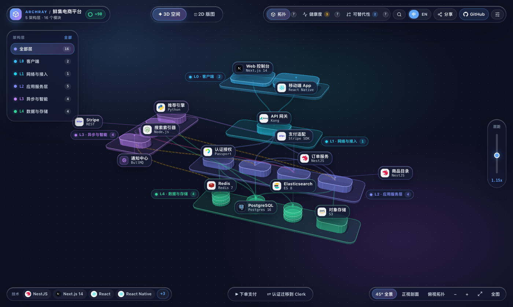
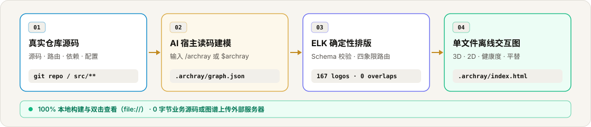
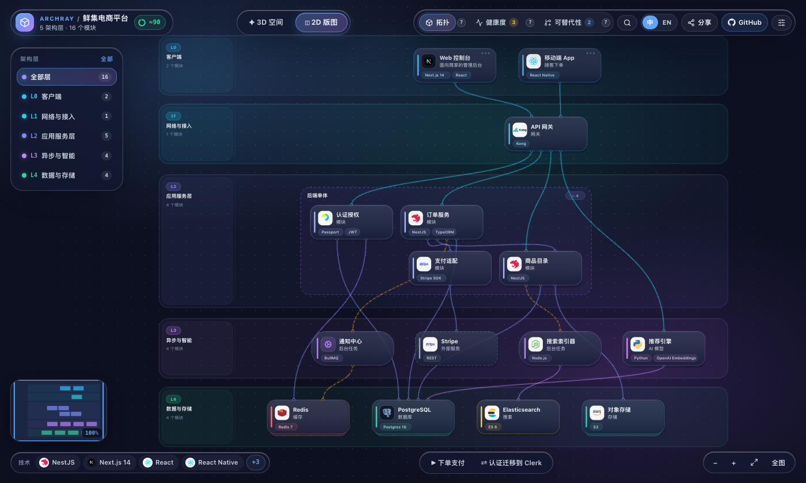
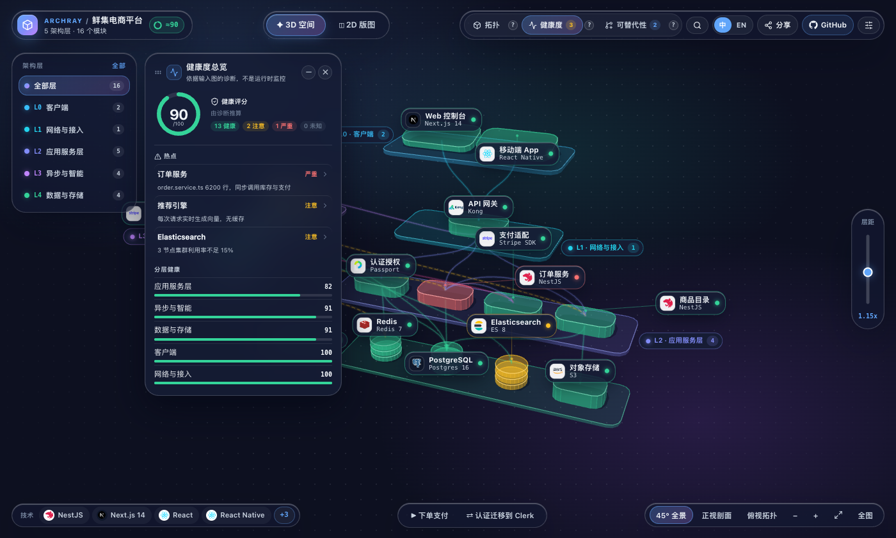
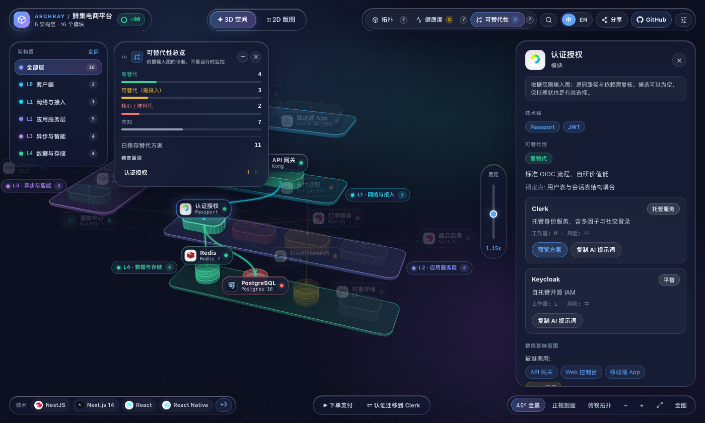
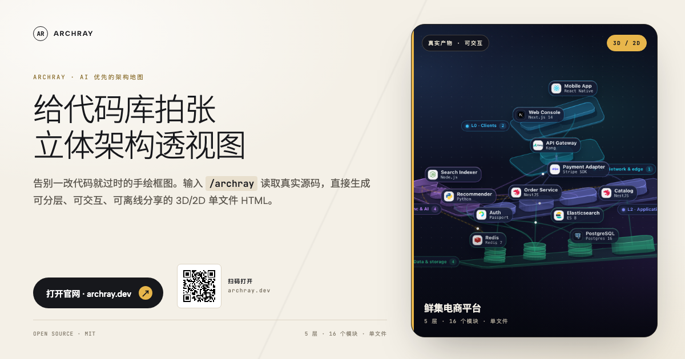
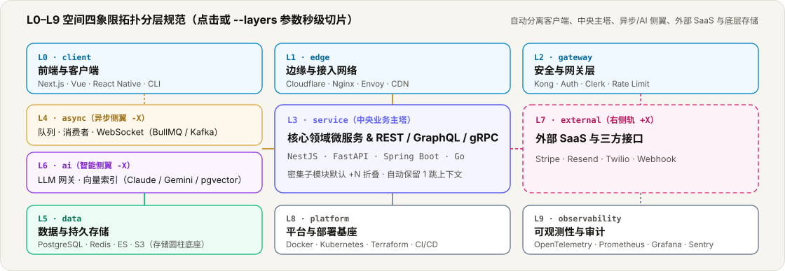

<div align="center">

<picture>
  <source media="(prefers-color-scheme: dark)" srcset="./docs/assets/readme/logo-mark-dark.svg" />
  <source media="(prefers-color-scheme: light)" srcset="./docs/assets/readme/logo-mark-light.svg" />
  
</picture>

<h1>ArchRay</h1>

<p><strong>让 AI 编程助手通读仓库真实源码，画出可分层、可交互、100% 离线分享的 3D 与 2D 空间架构图。</strong></p>

<p>
  <a href="https://github.com/loofare/ArchRay/releases/latest"></a>
  <a href="./LICENSE"></a>
  
  
  <a href="https://archray.dev/zh/"></a>
</p>

<p>
  <a href="./README.md">English</a> ·
  <strong>简体中文</strong> ·
  <a href="https://archray.dev/zh/">官方网站</a> ·
  <a href="https://archray.dev/demo?locale=zh-CN">在线 3D 沙盒</a> ·
  <a href="https://archray.dev/zh/guides/">使用指南</a> ·
  <a href="https://archray.dev/zh/compare/mermaid-structurizr-eraser/">工具对比</a>
</p>

<br />

<a href="https://archray.dev/demo?locale=zh-CN">
  
</a>

<p><sub>实机截图自 <a href="https://archray.dev/demo?locale=zh-CN">archray.dev/demo</a>：支持 3D 空间透视、2D Bento 版图、健康度热点与可替代性迁移方案——点击图片直接体验交互沙盒。</sub></p>

</div>

---

## 核心工程能力

<table>
  <tr>
    <td width="50%" valign="top">
      <p> &nbsp;<strong>真 3D 空间全景 + 2D Bento 双视图</strong></p>
      <p>VisionOS 风格悬浮控制岛搭配 <strong>ELK 确定性端口路由</strong>，在三维象限中天然分离前端入口、中央核心服务塔、异步/AI 侧翼（<code>-X</code>）、外部 SaaS 轨道（<code>+X</code>）与存储底座。</p>
    </td>
    <td width="50%" valign="top">
      <p> &nbsp;<strong>源码证据链与诚实边界</strong></p>
      <p>节点与连线绑定真实仓库 <code>sourcePaths</code> 与文件行号依据；严格区隔实测数据（<code>measured</code>）与静态估算（<code>≈</code>），绝不用 AI 臆测伪造线上监控指标。</p>
    </td>
  </tr>
  <tr>
    <td width="50%" valign="top">
      <p> &nbsp;<strong>健康度热点 + 可替代性平替闭环</strong></p>
      <p>自动定位高耦合巨石文件与锁定风险，对比开源自托管或云托管平替方案（工作量/风险评估），支持一键复制 AI 迁移 Prompt 发回编程助手。</p>
    </td>
    <td width="50%" valign="top">
      <p> &nbsp;<strong>零网络单文件 HTML 交付</strong></p>
      <p>产出自包含 <code>.archray/index.html</code>（<code>file://</code> 直接双击打开），离线内嵌 <strong>167 枚矢量技术栈徽标</strong>，支持无裁切高清整图 PNG 与离线二维码分享海报。</p>
    </td>
  </tr>
</table>

---

## 工作原理：语义事实与确定性排版解耦

大模型擅长读懂源码语义，但不擅长直接手算坐标或维持大图排版不乱线。ArchRay 将两者彻底分离，确保每次构建稳定可复现：

<div align="center">
  <picture>
    <source media="(prefers-color-scheme: dark)" srcset="./docs/assets/readme/pipeline-zh-dark.svg" />
    <source media="(prefers-color-scheme: light)" srcset="./docs/assets/readme/pipeline-zh-light.svg" />
    
  </picture>
</div>

---

## 视图画廊：四种实战视角切换

在同一份经过 `validate` 校验的 `.archray/graph.json` 上，无需再次消耗 Token 重读源码即可无缝切换视角与导出交付物：

<table>
  <tr>
    <td width="50%" align="center" valign="top">
      <a href="https://archray.dev/demo?locale=zh-CN&projection=2d&lens=topology">
        
      </a>
      <br />
      <strong>2D Bento 确定性版图</strong><br />
      <sub>L0–L4 自动分层嵌套容器 + 自适应折行 + 小地图联动</sub>
    </td>
    <td width="50%" align="center" valign="top">
      <a href="https://archray.dev/demo?locale=zh-CN&projection=3d&lens=health">
        
      </a>
      <br />
      <strong>健康度热点诊断透镜</strong><br />
      <sub>直观高亮 6,200 行订单同步锁等热点模块，实测与 <code>≈</code> 分标</sub>
    </td>
  </tr>
  <tr>
    <td width="50%" align="center" valign="top">
      <a href="https://archray.dev/demo?locale=zh-CN&projection=3d&lens=replaceability">
        
      </a>
      <br />
      <strong>可替代性与迁移 Prompt 生成</strong><br />
      <sub>评估 Passport → Clerk / Keycloak 改造投入与下游影响范围</sub>
    </td>
    <td width="50%" align="center" valign="top">
      <a href="https://archray.dev/zh/">
        
      </a>
      <br />
      <strong>高清整图 PNG 与离线分享海报</strong><br />
      <sub>按全图包围盒无裁切重投影，断网环境内置二维码海报直出</sub>
    </td>
  </tr>
</table>

---

## 1. 30 秒安装与首次生成

> **环境要求**：Node.js 20+、`curl`、`tar`（Windows 请在 Git Bash 或 WSL 中运行，会自动生成 `.archray\archray.cmd`）。

### 一行命令装入目标仓库根目录

```sh
curl -fsSL https://github.com/loofare/ArchRay/releases/latest/download/install.sh | sh -s -- . claude
```

把末尾的 `claude` 替换为你的 AI 编程宿主（支持逗号多选如 `claude,cursor` 或一键安装全宿主 `all`）：

| AI 宿主 | 安装参数 | 会话触发指令 | 写入仓库的适配器路径 |
|---|---|---|---|
| <picture><source media="(prefers-color-scheme: dark)" srcset="./docs/assets/readme/icons/claude.svg" /></picture> &nbsp;**Claude Code** | `claude` | `/archray`、`/archray:frontend` 等 | `.claude/skills/archray/`、`.claude/commands/` |
| <picture><source media="(prefers-color-scheme: dark)" srcset="./docs/assets/readme/icons/cursor-dark.svg" /><source media="(prefers-color-scheme: light)" srcset="./docs/assets/readme/icons/cursor-light.svg" /></picture> &nbsp;**Cursor** | `cursor` | `/archray`、`/archray-frontend` 等 | `.cursor/rules/archray.mdc`、`.cursor/commands/` |
| <picture><source media="(prefers-color-scheme: dark)" srcset="./docs/assets/readme/icons/antigravity.svg" /></picture> &nbsp;**Antigravity** | `antigravity` | `/archray` 或通过 Skill 匹配唤醒 | `.agent/skills/archray/`、`.agent/commands/` |
| <picture><source media="(prefers-color-scheme: dark)" srcset="./docs/assets/readme/icons/pi.svg" /></picture> &nbsp;**Pi** | `pi` | `/archray`、`/archray-frontend`、`/skill:archray` | `.agents/skills/archray/`、`.pi/prompts/` |
| <picture><source media="(prefers-color-scheme: dark)" srcset="./docs/assets/readme/icons/codex-dark.svg" /><source media="(prefers-color-scheme: light)" srcset="./docs/assets/readme/icons/codex-light.svg" /></picture> &nbsp;**Codex** | `codex` | `$archray` 或 `/skills` | `.agents/skills/archray/SKILL.md` |

<details>
<summary>不想敲终端？复制这段话发给你的 AI 助手让它帮你安装</summary>

```text
请下载 https://github.com/loofare/ArchRay/releases/latest/download/install.sh 到临时文件并校验后，在当前仓库根目录执行 `sh <临时文件> . claude`（将 claude 替换为你的宿主），完成后告诉我即可。
```

</details>

### 首次运行三步走

1. 安装完成后**重开一个 AI 编程会话**（使新斜杠指令生效）。
2. 输入 `/archray`（Codex 使用 `$archray`），或直接说：**“用 archray 分析源码并画出 3D 架构图”**。
3. 在浏览器直接双击打开本地生成的 `.archray/index.html` 即可交互查看。

---

## 2. L0–L9 空间分层与自由组合切片

一次审查源码写出 `.archray/graph.json` 后，无需重扫全库即可按单层或逗号组合秒级切片，直接相连的一跳上下游自动保持半透明上下文：

<div align="center">
  <picture>
    <source media="(prefers-color-scheme: dark)" srcset="./docs/assets/readme/layers-zh-dark.svg" />
    <source media="(prefers-color-scheme: light)" srcset="./docs/assets/readme/layers-zh-light.svg" />
    
  </picture>
</div>

| 目标视角 | 斜杠命令 / 参数 | 渲染焦点与说明 |
|---|---|---|
| **查看全部（默认）** | `/archray` 或 `/archray:full` | 展示 `L0–L9` 完整仓库拓扑 |
| **前端视角** | `/archray:frontend` 或 `/archray frontend` | 聚焦 `L0 client` 客户端与应用入口 |
| **后端与异步** | `/archray:backend` 或 `/archray backend` | 聚焦 `L3 service` 业务服务与 `L4 async` 队列任务 |
| **数据与存储** | `/archray:data` 或 `/archray data` | 聚焦 `L5 data` 数据库、缓存、检索与对象存储 |
| **网络与接入** | `/archray:network` 或 `/archray network` | 聚焦 `L1 edge` 与 `L2 gateway` 入口网关链路 |
| **安全与鉴权** | `/archray:security` 或 `/archray security` | 聚焦 `L2 gateway` OAuth/OIDC、JWT 与限流边界 |
| **跨端自由组合** | `/archray frontend,backend`<br>`/archray 前端,后端,数据`<br>`/archray ai,async,data` | 支持中英文别名与逗号任意拼接 |
| **视觉主题 / 语言** | `--style blueprint --lang en` | 内置四套主题：`tech` / `blueprint` / `glass` / `paper` |
| **工具升级 / 卸载** | `/archray update` / `/archray uninstall` | 默认保留已有 `.archray/graph.json`、`view.json` 与 HTML |

---

## 3. 真实仓库基准实测 & 选型对比

在真实开源工程验证中，ArchRay 严格验证大型 Monorepo 不卡顿、标签零重叠，并从 v0.6.0 起强制检测 Windows 环境下的 UTF-8 无 BOM 编码（杜绝中文变成 `???`）：

| 验证仓库 / 样本 | 架构体量 | 布局与构建耗时 | 核验表现亮点 |
|---|---|---|---|
| **calcom/cal.com**（`ae027bb`） | `7,712` 文件 → `33` 模块 · `75` 边 · `7` 层 | Node 侧 ELK 布局 **`196ms`** | 密集子包自动 `+N` 折叠，60fps 流畅缩放 |
| **FreshMart Commerce**（官网沙盒） | `16` 模块 · `19` 边 · `5` 层 · Checkout 6 步 | 本地单文件瞬间构建 | 精确标记 `6,200` 行同步锁热点与 Clerk 迁移方案 |
| **SaaS Starter & RealWorld** | `43–49` 源文件 | **`0.03s`** CLI 构建 | 映射 App Router/Prisma/Stripe，捕获硬编码 `JWT_SECRET` |

- 想知道 ArchRay 与 **Mermaid、Structurizr C4 DSL、Eraser、Excalidraw** 在大仓排版与隐私上到底差在哪？查看完整评测：[ArchRay 工具选型对比矩阵](https://archray.dev/zh/compare/mermaid-structurizr-eraser/)。
- 更多集成文档与参考手册：[Claude Code 教程](https://archray.dev/zh/guides/claude-code-architecture-diagram/) · [Cursor 教程](https://archray.dev/zh/guides/cursor-codebase-visualization/) · [L0–L9 与 Graph v2 参考](https://archray.dev/zh/guides/architecture-layers-reference/)。

---

## 4. 命令行工具与维护（仓库根目录运行）

所有运行组件全部自包含封装于项目 `.archray/tool` 内，零全局依赖污染：

```sh
./.archray/archray doctor                                      # 检查内置资源、Schema 与 Node 版本
./.archray/archray validate .archray/graph.json                # TypeBox 校验 + 双语覆盖率 + UTF-8 无乱码检测
./.archray/archray build .archray/graph.json --force --no-open # 从已有图谱免 Token 重构离线单文件 HTML
./.archray/archray build .archray/graph.json --layers frontend,data --style blueprint --force
```

**版本升级与安全卸载：**

```sh
./.archray/archray update --check       # 只读检查最新版本，不改动本地文件
./.archray/archray update               # 校验 SHA-256 并升级（保留 graph/view/HTML）

./.archray/archray uninstall --dry-run  # 预览卸载文件清单
./.archray/archray uninstall            # 仅移除工具和宿主命令（保留 graph/view/HTML）
./.archray/archray uninstall --purge    # 连同 .archray/ 全部清除
```

<details>
<summary>从 v0.4.0 及更早版本升级（旧版无 update 子命令）</summary>

```sh
curl -fsSL https://github.com/loofare/ArchRay/releases/latest/download/install.sh | sh -s -- . auto --force
```

</details>

---

## 5. 隐私安全与边界声明

> [!NOTE]
> **100% 本地构建 · 零源码上传 · 诚实边界**
>
> - ArchRay CLI 与生成的单文件 `.archray/index.html` 完全本地离线运行，绝不向 `archray.dev` 或任何外部服务发送源码、路径、环境变量或架构数据；源码读取仅发生在你授权使用的 AI 编程助手会话中。
> - ArchRay 不是运行时 APM 监控或全链路追踪探针；节点 `sourcePaths`、健康度判断与替代建议属于静态代码审查输出，建议结合源码复核。
> - 仅主动执行 `update` 时会向 GitHub Releases 发起只读请求以读取版本清单与 SHA-256 校验值。

更多细节请参阅 [宿主兼容性矩阵](docs/host-compatibility.md) · [变更记录](docs/changelog.md) · [开源声明](NOTICE) · [MIT License](LICENSE) · [archray.dev/zh](https://archray.dev/zh/)。
